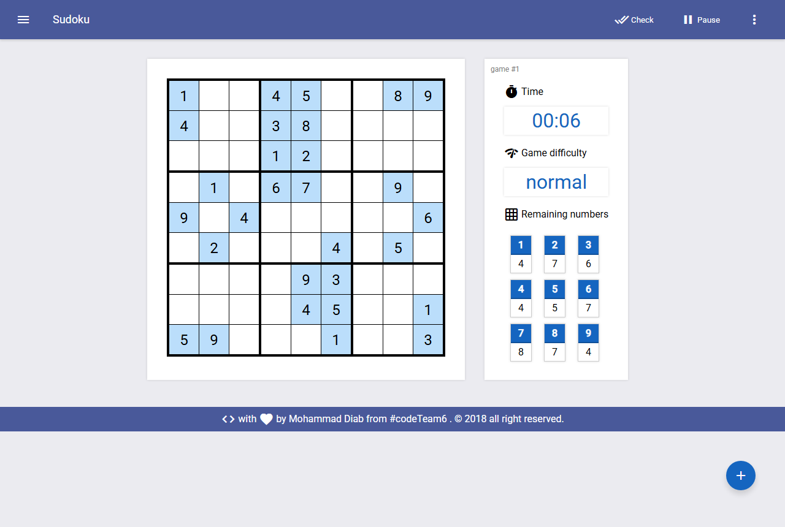

# Sudoku

A Sudoku game for the browser with a Material Design look: it generates a new puzzle at
five difficulty levels, keeps time, checks your answers, gives hints and can solve any
grid you type in. Plain HTML, CSS and JavaScript, no libraries. Built in 2018.

**Play it:** https://mohammad-diab.github.io/sudoku/

**CodePen:** https://codepen.io/editor/MohammadDiab/pen/01626bf9-e510-71e4-bca8-b0780cd577a8



## How to play

- Press **+** (or **New game** in the menu), pick a difficulty from Very easy to Expert and press **OK**.
- Fill the empty cells so every row, column and 3x3 block has the numbers 1 to 9. The panel on
  the right shows the time and how many of each number are left.
- **Check** colors every filled cell as right or wrong and adds one minute to the time. **Pause** stops the timer.
- The **more** menu (three dots) has **Hint** (fills one cell), **Restart** and **Surrender**
  (shows the solution).
- **Sudoku Solver** in the menu gives an empty grid: type a puzzle, then **Solve** it or ask
  **Is unique** to see whether it has only one solution.

## Run it locally

```
git clone https://github.com/Mohammad-Diab/sudoku.git
```

Then open `index.html` in a browser. Nothing to install or build. The icons and the Roboto
font load from Google Fonts.

## Author

Mohammad Diab

## License

[MIT](LICENSE)
